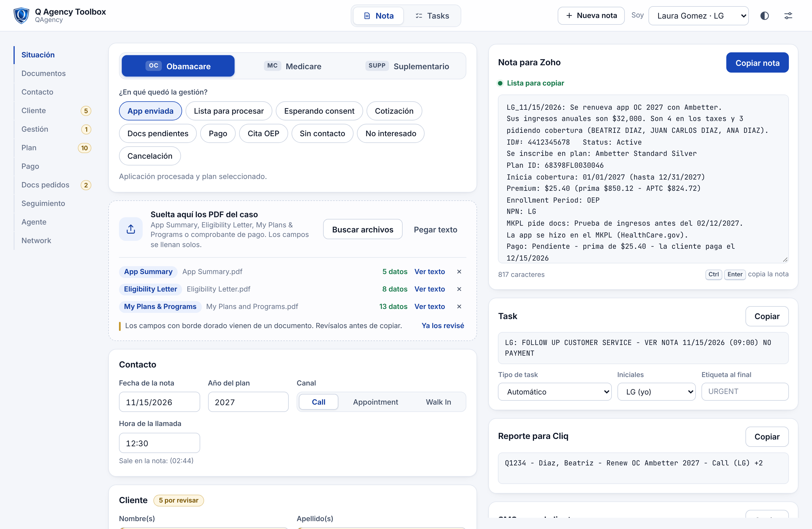
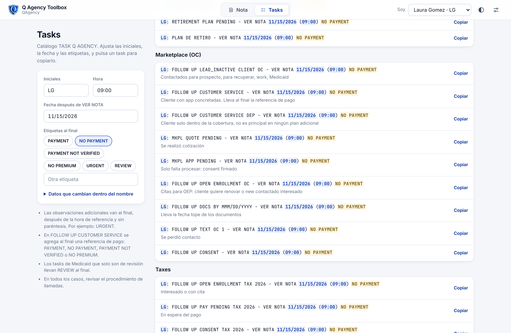

# Q Agency Toolbox

One app that turns a client contact into everything the team has to write afterwards:

- the **Zoho CRM note**, in the shape of the agency's PROCESS TEMPLATES
- the **task name**, in the TASK Q AGENCY format
- the **Cliq report line**, in the STANDARD FORMs - REPORT format
- the **SMS for the client**, signed with the office (QAgency or ATH Insurance)
- the **file names** for saving each document to the Network, per NOMBRE DE ARCHIVOS
- the **Consent** (Obamacare) and the **SOA** (Medicare) PDFs filled in with the client's data, with the Cliq line that asks Support to send them

Pick the line of business and how the contact ended, drop the PDFs or screenshots saved for the case, check the fields, copy.



A second tab, **Tasks**, is the web version of the TASK Q AGENCY document: every task name, with your initials, the date after VER NOTA and the closing tags filled in, one click to copy.



## Installing it

There are three ways to run it. All of them are the same app.

| | How | Good for |
| --- | --- | --- |
| **Windows package** | Unzip `dist/QAgency-Toolbox-Windows.zip`, double-click `Instalar.bat` | A real desktop app: Start menu and Desktop shortcut with the agency icon, its own window, pin to the taskbar. No admin rights, no internet. |
| **Single file** | Open `dist/QAgency-Toolbox.html` in Chrome or Edge (Brave works, but cannot save to the Network) | Trying it, or a computer where nothing can be installed. |
| **Hosted** | Put the repository root on any static web host (no build step needed) | One address for everyone, an **Instalar** button in the browser, works offline after the first visit, and updates reach the whole team on their own. |

The OCR engine with its Spanish and English models and the six Consent and SOA templates are bundled, so the single file is about 17 MB.

The Windows installer copies the app to `%LOCALAPPDATA%\QAgencyToolbox` and creates shortcuts that open it in app mode with Chrome or Edge, whichever it finds first. Brave is used only when neither is installed, because Brave blocks choosing a folder, so it cannot save to the Network. The shortcuts open it with a browser profile of its own (`--user-data-dir` in `%LOCALAPPDATA%\QAgencyToolbox\Navegador`): without a fixed profile, Chrome opens an app shortcut in whichever profile was used last, so with several Chrome profiles the settings seemed to vanish between sessions. Settings are kept across updates as long as the same browser opens it. Moving to the tool's own profile starts it empty once; the installer says so and lists what to set up again (import the team, your name, the office, the Network folders). A taskbar pin is a copy of the shortcut that never changes by itself, so a pin made before the own profile kept opening the browser's last-used profile; the installer (and so every update) now rewrites any pin in `%APPDATA%\Microsoft\Internet Explorer\Quick Launch\User Pinned\TaskBar` that opens the installed copy, and leaves other pins alone. The shortcuts open the page with `?perfil=propio`; the installed copy opened any other way (an old pin, a double-click on the file, a bookmark) shows a notice that this window does not see the saved settings, with **Exportar equipo** to carry the team over to the window the icon opens.

**Updating.** The installed app asks GitHub for the latest version number when it opens (only when opened as a file, and only that one address: `connect-src` allows nothing else). When it is newer, a bar says so and the **Actualizar** button in the top bar turns blue (`Actualizar a 1.22.1`). The button is always there in the installed copy: it opens the `qagency-toolbox-update:run` link, which the installer registers for the user under `HKCU\Software\Classes` (no admin rights), and Windows runs the installed `actualizar.ps1`. The link passes nothing to the updater, so the most any page could do with it is start a check for a signed newer version. It runs without a console window (`conhost --headless`, or a hidden window on Windows older than 10 1809) with `-Oculto`, which skips the *Pulsa Enter* pause and shows the result in a Windows message box: up to date, done (close and reopen the tool), no internet, or the error. The first time, the browser asks whether to open the updater; choose *Abrir*. The **Actualizar Q Agency Toolbox** shortcut in the Start menu does the same; the old one on the Desktop is removed. The updater runs `actualizar.ps1`: it compares the installed version with `package.json` on `main`, and only when GitHub's is newer downloads `dist/QAgency-Toolbox-Windows.zip` and its signature `dist/QAgency-Toolbox-Windows.zip.sig`, verifies the signature before opening the package, checks that the package inside really is that version, and runs its installer. Otherwise it says the app is up to date and changes nothing; `-SoloRevisar` downloads and verifies without installing.

**Signed packages.** The updater installs only a package signed with the publisher's private key (RSA 3072, SHA-256); the public key is written in `actualizar.ps1`. The private key is never in the repository: it lives at `private/update-signing-key.pem` (ignored by git) or wherever `QA_SIGNING_KEY` points. So someone who gets into the GitHub account can change the files there, but cannot produce a package the updater accepts: an unsigned, altered or differently signed package is refused with *El paquete de GitHub no tiene una firma valida de Q Agency. No se instalo nada.* Keep a backup of the private key somewhere safe outside this computer and outside GitHub; without it no further update can be published, and a new key means one manual install on every computer. `node tools/sign.js --new-key` creates a key (once) and writes its public half into `actualizar.ps1`. Turn on two-step verification on the GitHub account as well: the signature protects the package, not the account. The very first install, by hand from the package, is not checked by anything.

To publish an update, bump the version (`js/config.js`, `package.json`, `sw.js`), run `node tools/build.js` on the computer that has the key (it signs the package and warns loudly when it cannot) and merge to `main` with the rebuilt `dist/`, `.sig` included. Computers on 1.9.0 or older have no updater yet, so they need one manual install of the new package. Running `Instalar.bat` from a new package still works too. Each browser keeps its own settings, so after an update that moves the app from Brave to Chrome or Edge, fill in Ajustes once more. `Desinstalar.bat` removes it. The installer has not been run on a real Windows machine yet, so try it on one computer before sending it to the team.

If you host it, keep the host private or clear the roster first: `js/config.js` contains the team's names and NPNs.

## Using it

1. Choose who you are at the top right (once; the browser remembers it).
2. **Nota** tab: every new note (the app just opened, or **Nueva nota**) starts on a start screen with a greeting, three big cards (Obamacare, Medicare Advantage, Suplementario) and a drop zone. Choose a card, or drop the case's documents there: a document picks its line by itself. Then choose the situation.
3. Drop the PDFs or images anywhere on the window, or paste a screenshot with Ctrl + V. The form's sections close to a one-line summary of their values, and several can be open at once. Which ones is chosen by itself only at calm moments, never while you type: with no documents yet, all of them (you are filling the note from zero); after a document is read, the ones with something to review or choose. Click a section's header to open or close it, its name in the list on the left to jump to it, or **Abrir todo / Cerrar todo** in the bar above the form. Fields go in two columns, and the household section is split into *Titular*, *Dirección, teléfono y email* and *Personas del hogar*. Sections, and the *Antes de copiar* list, slide open and closed; with Windows' *Show animations* turned off they switch at once. Fields filled from a document get a gold edge, and the list on the left shows how many are waiting to be reviewed in each section. When the values are right as they are, **Están bien** next to a section's count clears its gold (household rows included) closes it and takes you to the next section with something to review, with the cursor on its first gold field; button-style options and checkboxes filled from a document are gold too. And **Ya los revisé** clears it everywhere; a household member turns gold again only if a later document brings a new value. **Canal**, **Código en Zoho** and **Enrollment Period** (or *Período de elección* in Medicare) almost never come in a document, so they show in red with *elígelo* until you pick an option (even the one already on) or confirm the section; until then they also appear under *Antes de copiar*. A section's count says how many values are *por revisar* (gold, read from a document) and how many are *por elegir* (amber). The bar above the form adds them up and walks you through them one by one: **✓ Bien, siguiente** (or **Alt + Enter**) confirms the value where the cursor is and moves to the next one, household rows included; at the end the cursor goes to *Copiar nota*. In button-style choices, Tab stops once and the arrow keys move between the options.
4. Complete what the documents don't carry.
5. **Copiar nota** (or Ctrl + Enter), then copy the task and the report line. The right column shows one text at a time, in tabs (Nota, Task, Reporte, SMS, Email: only those the situation has); what is still missing shows as one line, *Faltan N datos antes de copiar*, that opens the list.

The note, task and report can be edited by hand before copying. If you edit the note and then change a field, the note is left alone until you press **Regenerar**.

**Household income** follows the Marketplace rule: a tax dependent's income counts only if they must file a federal return. With one yearly amount per person it is taken as earned income, so a dependent's income counts above the single standard deduction for the plan year ($16,100 in 2026, $16,600 in 2027); the title holder, the spouse and anyone the App Summary says files their own return always count, and *Antes de copiar* says whose income was left out.

**Hora de revisión del task** fills itself with the exact time the first document is loaded (unless you already set it). Type it (`2`, `234`, `2:34pm`, `14:34`; from 1 to 6 without AM/PM means the afternoon) or pick it from the grid; the arrow keys move it half an hour. The note keeps the exact time (`Se conversa con la cliente (02:34)`); the task after VER NOTA takes the :00 or :30 it falls in (09:13 → 09:00, 09:34 → 09:30).

The task dropdown only lists the tasks of the line you are in (Marketplace for Obamacare, Medicare for Medicare, Supp for Suplementario); every other task is in the **Tasks** tab. **Etiquetas al final** has *CRONIC* and *URGENT*: tick one or both and they go at the end of the task in that order (`… VER NOTA 11/15/2026 (09:00) CRONIC URGENT`).

### Obamacare

There are three situations:

- **App enviada.** *Hogar* has the titular's address, phone and email, and lists the people in the application: the titular (named as in Zoho) and everyone else, each with *Taxes* and *Cobertura* toggles and, when opened, their relationship, US status (citizen, resident, work permit or something else, typed), DOB and yearly income. The note counts taxes and coverage and names them: `Sus ingresos anuales son $32,000 (Beatriz $25,000, Juan $7,000). Son 3 en los taxes (Beatriz, Juan, Ana) y 2 pidiendo cobertura (Beatriz, Juan).` *Plan* keeps company, plan name, status, coverage start and the monthly premium the client pays. *Documentos que pide el Mercado* is a checklist: what the Marketplace asked for (the 11 data matching issues from healthcare.gov), for whom, the due date, and once **Enviado** is ticked, which document was sent. While the Marketplace is asking for any document, sent or not, the automatic task is `FOLLOW UP DOCS BY` the earliest due date of all of them; otherwise `FOLLOW UP CUSTOMER SERVICE` with the payment tag. Only **Pago confirmado** writes in the note (the `Pago:` and `AutoPay:` lines); **Pendiente de pago**, **Pago no verificado** and **Sin prima** only add their tag to the task: `NO PAYMENT`, `PAYMENT NOT VERIFIED` or `NO PREMIUM`. The note always goes in the principal's profile, so there is no dependent option (`FOLLOW UP CUSTOMER SERVICE DEP` can still be picked by hand).
- In Obamacare, from plan year 2027 (or while the year is still empty), anyone asking for coverage whose status is *Permiso de trabajo* or *Otro* gets an alert under *Antes de copiar* to review their subsidy: from 2027 the Marketplace subsidy (APTC and cost-sharing reductions) is only for citizens, lawful permanent residents, Cuban/Haitian entrants and COFA migrants (H.R. 1, section 71301). It says *review*, not *not eligible*, because a Cuban/Haitian entrant keeps it.
- In Obamacare with **Enrollment Period** on OEP, **Cobertura desde** fills itself from the note date: `01/01` of the next year when processed from November 1 through December 15, and `02/01` from December 16 through January 15. A date you type, or one that comes in a document, stays; switching away from OEP clears the one it filled.
- **Pendiente** covers quotes, consents waiting for signature and apps ready to process. *Planes cotizados* takes as many plans as were discussed, one line each in the note, with **Seleccionar** for the one the client chose and **Revisará los planes** when the quote is sent or handed over for review. Network only has the consent: the note ends with `Carta de consentimiento enviada.` or, once received, `Se firmó la carta de consentimiento en línea, app pendiente.` (call) or `en la oficina, app pendiente.` (in person). With **Revisará los planes** the note ends with the quote line instead (`Se le envía la cotización para que revise los planes.`, or `el plan.` when only one was quoted, and `entrega` in person) and says nothing about the consent, which is not sent until the client picks a plan. **Consent para firmar**, **Hoja de cambios** and the Network section hide, since there is no consent or application yet. It also shows **Email para el cliente** with the quote, in Español or English: the company, each plan's name and monthly premium, and the coverage start; with several plans each one gets its own lines, and with several companies each company is listed with its plans. The task is `FOLLOW UP CONSENT`, `MKPL APP PENDING` once the consent is in, or `FOLLOW UP OPEN ENROLLMENT OC` if the client will review the plans. No SMS. Below the form, **Consent para firmar** fills in the consent letter (see *Consent and SOA*); it hides once *Carta de consentimiento recibida* is checked.

  **Hoja de cambios** (below the consent) is the one-page summary for the collaborator who completes the application, on top of the note: the portal to use, the client as in Zoho, Zoho code, agent, collaborator, the previous NPN (the agent of the last document dropped) next to the selected one, the consent status, the chosen plan with premium and coverage start, contact details and language, and each household member with DOB, sex, taxes, coverage, immigration status and yearly income, plus the household total. Highlighted values changed from the documents of the previous process (the same baseline as *Cambios*); added members are marked *Nuevo* and removed ones crossed out. **Imprimir o guardar PDF** prints only the sheet; in the print dialog, *Save as PDF* proposes the Network-style name `Diaz, Beatriz - OC_Change Sheet 2027`. **Guardar en la carpeta** (Chrome and Edge) writes the sheet as a text PDF with that name straight into the Hoja de cambios folder (see *Carpetas del Network*), so names and codes can still be copied from it. On Pendiente, a document from the previous year (last year's App Summary) does not replace a newer plan year.
- **Cancelación** asks for the reason (too expensive, coverage through work, immigration status or other), what is being cancelled, the company and the agent, and whether it is **Cancelada** (the coverage never started: a renewal for next year, or an application cancelled before the effective date, or after it without payment) or **Terminada** (the coverage ends in a given month, for example when moving to Medicare or to job-based insurance). Cancelada asks for the coverage start and ticks *My Plans & Programs (CANCELLED)*, whose file name takes that month and ends in `CANCELLED`; Terminada asks for the termination date and ticks *My Plans & Programs (TERMINATED)*, whose file name takes the month the coverage ends and ends in `TERMINATED`. The report process ends in `_Cancelled` or `_Terminated` to match. The task is `FOLLOW UP LEAD_INACTIVE CLIENT OC`.

**Cambios.** In *App enviada* and *Pendiente*, whatever ends up different from what the documents filled in goes in the note under `Cambios:`, one line per change, right after the household line:

```
Cambios:
- Beatriz: ingreso anual $25,000 (antes $32,000), estatus Residente
- Juan: no pide cobertura
- Se agrega a ANA DIAZ (Hijo/a), DOB 05/02/2020, estatus Ciudadano
- Se quita a PEDRO DIAZ
- Dirección: 456 Oak Ave, Miami, FL 33125 (antes 123 Main St, Miami, FL 33101)
- Teléfono: (305) 555-0199
```

A change is a value edited, cleared or toggled after a document filled it (shown with `antes`), a person added by hand to a household that came from a document, or a person from a document removed. Address, phone, email, US status and DOB also count when they are typed where no document had them. With no documents loaded there is nothing to compare against, so only those last five can appear.

### Medicare Advantage

There are two situations:

- **App enviada.** Whoever writes the note talked to the client and processed the app, so there is no collaborator. The note opens with the *Canal*, as in Obamacare: `ER_02/01/2026: Se atiende al cliente en la oficina (09:00), se procesa app de MC con Humana.` (`Se conversa con el cliente` on a call, `en cita …` for an appointment). *Fecha del SOA* is the date of the note unless it is changed, and the SOA is ticked in Network like any other document. The contract (H-PBP) is part of the plan name; when the application shows it apart, the reader appends it. **Tiene prima mensual** shows the premium; off, the note says `Premium: $0.00`. The note says `App ID: …` and `Medicaid ID: 12345678`, and Network has the SOA and the App. The SMS is the agency's official Medicare SMS (see *SMS, email and file names*), and there is no email.
- **Sin cambios.** The client reviews their plan and keeps it, so it only asks for the client, the plan name and the SOA: `ER_11/14/2026: Se atiende al cliente en cita telefónica (09:00), se revisan los beneficios de su plan para 2027 y decide mantenerse en su plan actual - Humana Gold Plus H1036-077 (HMO)`. The report line is for the NO CHANGE channel in Cliq: `Diaz, Beatriz se quedara en su mismo plan Humana Gold Plus H1036-077 (HMO)`. The task is `MC MANTENIMIENTO`, or `FOLLOW UP LEAD_INACTIVE CLIENT MC` when **Es cliente** is off. No SMS.

In both, *Cliente* also has the client's phone and email, which only feed the SOA's Cliq line and signing link, and the **Dirección**, which is only there to confirm it with the client: it goes in no note, task, report, message or form, and the Medicare application fills it in when it has one. Below the form **SOA para firmar** downloads the Scope of Appointment (see *Consent and SOA*); it hides once the SOA is ticked in Network.

### Consent and SOA

**Consent para firmar** (Obamacare *Pendiente*) and **SOA para firmar** (Medicare, both situations) work with the agency's PDF forms, which are bundled with the app. The consent template follows the agency of the agent whose NPN is used, when that agent has one chosen in **Ajustes → Equipo** (column *Agencia*); otherwise it follows the office chosen at the top of the screen, under *Q Agency Toolbox* (QAgency or ATH Insurance; the same choice is in **Ajustes**). The section says which office's Consent it will use, and why, so it can be checked before sending; both follow the language switch in the section (Español / English), which is the same client language the SMS uses.

- **Consent:** client name, consent date (the note date, also on page 2), agent and NPN (from *Agente (NPN)*), marital status (*Casado/a* or *Married* when the household has a *Cónyuge*; otherwise what the App Summary says; a case typed by hand with no spouse is *Soltero/a* or *Single*), yearly household income, people in the taxes, people asking for coverage, and the selected quoted plan with its premium (the only quoted plan when none is selected).
- **SOA:** nothing is filled in. Every field on the SOA is in the agent's section, which the agent completes and signs after the client signs, so **Descargar PDF** downloads the form as it is, with the five product boxes checked as they are on both SOAs. The beneficiary's name and phone from the note are used only for the Cliq line and the SMS.

The section shows the document on screen exactly as it will come out, filled from the note and redrawn a moment after a value changes. Nothing is typed there: every value comes from the note, so a wrong value is fixed in the note field it comes from. **Descargar PDF lleno** fills the consent in the browser and downloads it with the Network file name (`Diaz, Beatriz - OC_Consent Ambetter 2026 NOV.pdf`); the SOA downloads the same way (`Diaz, Beatriz - Medicare_Humana_SOA 2026 NOV.pdf`). Signature fields are left empty; the consent's signature date (*Fecha de la Firma*, *Date of Signature*) gets the same date as the rest. **Para pedirlo en Cliq** has the line to copy, with the client named as in Zoho, like every internal Cliq message: `Enviar CONSENT a Diaz, Beatriz al bea@example.com y al (305) 555-0100 pls @Support Agency` (or `Enviar SOA a …`), without the email or the phone when it is missing.

**Sending for signature (DocuSeal).** The Windows package installs a signing helper, `signing-helper.ps1`, that talks to the agency's DocuSeal server through its API, so the client's values travel in an HTTPS request body, never in a link. In **Ajustes → Envío a firmar (DocuSeal)**, type the number of each DocuSeal template, the one in its address (`…/templates/5`), for the six forms: Consent QAgency Español, Consent QAgency English, Consent ATH Español, Consent ATH English, SOA Español and SOA English. In each template the client's signer is named `Cliente`, and in the SOAs the second signer is `Agente`; the fields keep the PDF's field names, which is how the app fills them. With the helper running, the office's signing code set, and the template number set, the section shows **Crear enlace de firma**. The link opens DocuSeal's signing page in the client's language, the section's Español / English switch, buttons included (*Firmar y Completar*, *Rechazar*); the agent's SOA link uses the same language. Without one of those, it says what is missing: the helper, the office's signing code, the template number, the client's email or name, or, for the SOA, the NPN agent.

- **No email is sent.** After a confirmation, the helper creates the submission with emails turned off, and the section shows **Enlace de firma del cliente**: the client's signing link, plus a short SMS and an email in the client's language, signed with the office name (the SMS also with the office phone from **Ajustes**), each with **Copiar** and with **Abrir en el teléfono** / **Abrir en el correo** when the client's phone or email is valid. The link stays there while the client has not signed, also when the note is filled again later: it comes back from Firmas when the file name and the client's email match. A warning says to use only test data until the agency's signing server has a BAA.
- **Consent.** Every field goes in filled and locked, with the same values as the preview on screen, so the client only signs.
- **SOA.** The client signs first, with nothing to type. The agent's section is filled only after that, right before the agent signs: the agent's name, NPN and personal phone (the *Tel. SOA* of the NPN agent in **Ajustes → Equipo**: the number the carrier has on file, never the agency's *Directo*; without it the SOA is not sent), the beneficiary's name and phone, the address, the initial contact method (*Book of Business*), the plans discussed (the company the client chose) and the appointment date (the day the client signed). Values with data are locked. A value the note does not have stays empty and optional, so the agent can type it; phones go in their digit boxes only with 10 digits. With everything in the note, the agent only signs.
- **Signed documents.** Every minute, the app asks the helper what changed; the **Firmas** tab lists it (below). When a document is fully signed, the signed PDF is saved byte for byte, so its signature seal still validates. It is one PDF: the signed document followed by DocuSeal's audit trail, the signature certificate that shows who signed, when, from which IP address and how they were verified, sealed together by the server. It is saved in that document's Network folder with its Network file name (`Diaz, Beatriz - OC_Consent Ambetter 2026 NOV.pdf`), without asking. That happens only when the folder is already chosen and allowed, no file with that name exists there, and it was not saved before. Otherwise the document's row in **Firmas** says why and offers **Guardar**, which can ask for the folder or permission and asks before replacing a file, and **Descargar**, a normal download. After a download, **Ya lo guardé** confirms the file was kept. The saved mark is kept by this computer's helper (`firma\guardados.txt`, only the document numbers), because DocuSeal does not let anyone change a signer who already signed. Saving deletes nothing: the document stays on the signing server as the history. When the signed document belongs to the note that is open, it is also ticked in Network.
- **Firmas.** The **Firmas** tab, next to Nota and Tasks, appears when the helper is installed. It lists what was sent for signature from this computer, newest first (each computer's helper makes its own number, `firma\equipo.txt`, and tags every document it sends with it; documents sent from other computers or by an older version are not listed, and stay on the signing server): the client, the Consent or SOA with its Network file name, when it was sent, who sent it (**Enviado por**, the person using the app), when it last changed, and its status. The filters are **Esperan la firma**, **Firmados** and **Sin firmar** (declined or expired). A badge on the tab counts signed documents not yet saved on the Network. While the client has not signed, a document has **Copiar enlace** and **Cancelar envío**, for one sent by mistake. Once the client signed a SOA, it has **Firmar (agente)**, which fills and locks the agent's section and opens the agent's signing page in a new tab, so the agent signs from the computer that sent it. One that ended unsigned has **Borrar**. Cancelling or deleting archives the document on the server after a confirmation; just before, the helper asks for the status again, so a signed document is never archived. A signed document cannot be deleted from the app; it keeps **Descargar**. The history loads 25 at a time (**Ver más del historial**), and documents still waiting for a signature are always listed.
- **The helper.** It listens only on `127.0.0.1:47815`, and the page's Content-Security-Policy allows only that address. It rejects any other `Host`, any `Origin` other than the tool's `file://` page, requests without the installer's per-computer token, and non-JSON bodies. It keeps no client data on disk: the client's name and email, the file name, the folder and the agent's values travel with the submission on the server (in its metadata), and the helper keeps them only in memory. Its log (`firma\registro.log`) records what happened, never client data, links, the signing code or the token.
- **The key stays on the server.** No computer has the DocuSeal API key. The signing server's address is built into the helper, and the server runs a gateway in front of DocuSeal that holds the key. Each office has a signing code, made by the server: the page sends it with every request, the helper passes it on as `X-Office-Code`, and the gateway adds the key only to a request with a valid code and only for the calls the helper makes (create, read and archive a submission, download its documents, fill a signer). Anything else with a code gets `403`; a wrong code shows *El servidor de firma no aceptó el código de la oficina*. Signed PDFs are downloaded without the code. In **Ajustes → Envío a firmar (DocuSeal)**, each office's code is typed once, hidden like a password, and **Exportar equipo** puts the codes in the team file with the template numbers; **Importar equipo** on the other computers copies them. The team file is a secret: share it only inside the office. Changing the key or the codes is done once on the server, never on each computer. The installer starts the helper now and at every logon (a Startup shortcut) and writes `helper-config.js` next to the installed app with the per-computer token. Installing or updating over 1.25.0 or 1.25.1 deletes the key and server address those versions saved (`firma\clave.txt`, `firma\ajustes.json`). **Desinstalar.bat** stops the helper and removes all of it; the documents stay on the signing server.
- **The signing server.** `tools/docuseal/crear-servidor.sh`, run in Google Cloud Shell, creates the DocuSeal server the first time (a fixed IP, a firewall with SSH only through IAP, an e2-micro VM, daily disk snapshots and a 20 USD budget alert). Once DocuSeal is set up, running it again asks for the DocuSeal API key, hidden as it is typed, sends it to the server over SSH (IAP) into `/srv/docuseal/pasarela.env`, makes the two office codes there and prints them. The key is never saved in Cloud Shell or on any computer. Pressing Enter keeps the key the server has; `bash crear-servidor.sh --codigos-nuevos` replaces both codes, for example if the team file leaves the office, and then a new team file is exported and imported. Until the gateway has a key and two valid codes, a request with a code gets `503`. Requests without a code reach DocuSeal as before.

The English SOA came without form fields, so `tools/make-fillable-soa.js` added them once, in the same places as the Spanish one (the phone goes in its digit boxes). To change a template, put the six PDFs in a folder and run `node tools/vendor-forms.js <folder>`.

### Suplementario

There are two situations, and *Tipo de gestión* is a new application or a renewal:

- **App enviada.** *Members* works like the Obamacare household: the titular's address, phone and email, and each person with a **Cobertura** toggle and their DOB. The note names whoever has coverage by first name: `Se procesa app de Hospital de GR para el cliente, Maria y Luis.` The plan keeps the product, company, plan name, premium, effective date and Policy # (no App ID or plan type). *Pago* is **Pago confirmado** or **Pendiente de pago**; only Pago confirmado writes in the note. Whoever writes the note processed the app, so there is no collaborator. **Email para el cliente** has one part with its own **Copiar**, in Español or English: the company, `ID #` (the Policy #), the coverage start and the monthly premium, signed by whoever talked to the client. The SMS is the agency's official Supplemental SMS (see *SMS, email and file names*); the note keeps its current text until the agency's standard format is ready.
- **Cotización.** Same *Members* and *Gestión*; the plan has no App ID or Policy #, and the date is **Fecha efectiva estimada**, which goes in the note after the quoted plan. Covered people besides the titular are named: `desea cotizar seguro dental para el cliente y Maria.` The SMS keeps its current text. The **Email** card has the quote text to paste into the agency's quote template, in Spanish or English: `Se envía cotización del Plan de Accidente … de la compañía …` / `Here is your quote for the Accident Plan … from …`, with the estimated monthly premium, the brochure line, the tagline and the signature. Accident and Hospital are named as in their templates (*Plan de Accidente*, *Hospital Plan*); other products as in the SMS (*seguro dental*, *dental insurance*).

### Companies

Obamacare and Medicare pick the company from the agency's official list, in this order, or **Otra**, which asks for the name:

- Obamacare: Florida Blue, Ambetter, Wellpoint, UHC, Oscar, Cigna.
- Medicare: Humana, UHC, Aetna, Florida Blue, BCBS of (with the state in two letters), Healthspring, Devoted, Freedom, Simply.

The note, the report and the file names use the short form: `FB` for Florida Blue, `BCBS of GA`, `Healthspring`. A company read from a document is matched to its option; one outside the list (Molina, AvMed, Wellcare…) comes in as **Otra** with its name. Suplementario keeps a free company field with suggestions. The list lives in `js/config.js`: the carriers with `option` are the official ones.

### People

**Ajustes** shows one section at a time: Oficina, Equipo, Carpetas, Firma, Nota and Instalación, listed on the left (a row of tabs on a phone; the arrow keys move between them). Under each name is how it stands (*2 personas*, *Sin elegir*, *Falta el Tel. SOA*), and an amber dot marks the sections that still need something: an agency without a phone, an empty team, an agent with an NPN and no *Tel. SOA* (its box is outlined too), no Network folder chosen or one the browser lost, or signing templates without an office code. The long explanations are folded under **Cómo se usa** in each section.

Each person in **Ajustes → Equipo** has the initials they sign notes and tasks with, and, if different, the initials they appear with as agent in the Cliq report (someone can sign notes as DI and be agent LI), plus an optional direct phone that goes under their signature in the SMS of a sent app. Agents also have a *Tel. SOA*: their personal phone, the one the carrier has on file, which goes on the SOA instead of the agency direct line. Both phones travel in the team file.

The team is not in the code: the repository is public, so names and NPNs stay out of it. The office keeps a team file, `QAgency-Equipo.json`, and shares it privately (for example on the Network). Each person loads it once with **Importar equipo**; the list then lives in that browser, and a browser that already had a team keeps it. **Exportar equipo** writes the current list to that file to pass it on. A file that is not a team file shows a message and changes nothing; importing over an existing list asks first. People without a name are skipped, a repeated name keeps its first entry, and initials, NPN and phone are cleaned up on the way in. The file also carries the signing template numbers from **Ajustes**; importing it fills in the ones it has and leaves the others as they were (an older file with SignWell links still imports, and the links are ignored). Your name and the office chosen at the top are not in it, since they differ per person.

*Agente y colaborador* has three roles: **Habló con el cliente**, **Agente (NPN)** (a list of the agents with their NPN) and **Colaborador** (who processed the application). They default to whoever writes the note. Medicare and Suplementario have no **Colaborador**: whoever writes the note processed the app. The note says `NPN: LI` (the NPN is enough, so there is no Writing ID), and names who talked to the client and who processed the app only when it was someone else. When the person who talked to the client is not the one who processed the app, the report line starts with their initials (`FV: Q1234 - … (LI)`); a checkbox under the report switches that on or off.

### The note

Each situation writes the note the way PROCESS TEMPLATES does: `ER_11/09/2026:` and one sentence, then the case data in the agency's own labels (`ID#`, `Status`, `Inicia cobertura`, `Premium`, `Enrollment Period`, `MC #`, `PART A`, `Conf/App #`, `Effective Date`, `Monthly Premium`, `AutoPay`…), the agent as `NPN: LI`, and `Docs en mi folder del NETW: …`. **En la nota** switches between *el cliente* and *la cliente*.

In Medicare, the **Se completó el HRA (Health Risk Assessment)** checkbox only adds that line to the note, before the Network documents, in both Medicare situations and whether the client speaks Spanish or English; it changes nothing else.

A submitted application ends with «Se reporta en el botón rojo» (it can be switched off in Ajustes). The task never goes in the note; it is only in the Task box.

The note never asks for or includes Marketplace usernames, passwords or security questions.

### SMS, email and file names

The SMS card writes a short message for the client: what was done and what they need to do next, greeting them by first name and signed by the agency of the agent whose NPN is used (set per agent in **Ajustes → Equipo**, column *Agencia*) or, when that agent has none, by the office chosen at the top of the screen (or in Ajustes), with that agency's phone number if one is set. **Ajustes → Oficina** has one phone field per agency (QAgency and ATH Insurance), so the SMS gets the right number whichever agency signs it. The email and the signing-link messages follow the same agency. The *Agencia* column travels in the team file (**Exportar equipo** / **Importar equipo**). The counter shows how many text messages it takes; accents or emoji make each one hold 70 characters instead of 160.

For an Obamacare **App enviada**, the SMS follows the agency's format, in **Español** or **English** (the switch on the SMS and email cards):

```
Estimado Miguel: Somos QAgency Insurance. Hemos renovado su seguro de salud 2027 con Florida Blue.
Plan: myBlue Essentials Silver 27M07-01C
Inicio: 01/01/2027
Premium: $85.40/mes
Revise su email y para cualquier duda, comuníquese de inmediato con nosotros. Saludos Daniel Rivas
Directo: (239) 555-0101
Oficina: (239) 555-0102
🎁 ¡Por cada 4 personas que nos refiera, gana una GIFT CARD!
```

It is signed by whoever talked to the client, with their direct phone from Ajustes and the office phone. The first sentence follows *Tipo de gestión*: renewed, enrolled (new application) or updated (life change). *Estimado* becomes *Estimada* with *la cliente*.

Medicare and Supplemental **App enviada** use the agency's official SMS, with the same switch, signature and office name:

```
Estimado Miguel:
Somos ATH Insurance. Le confirmamos que su inscripción en Medicare para el 2027 se ha completado con éxito.
Compañía: Humana
Plan: Gold Plus - Diabetes and Heart (HMO C-SNP) H1036-311-000
Fecha de efectividad: 01/01/2027
Para cualquier duda, comuníquese de inmediato con nosotros. Saludos
Ana Ruiz
Directo: (305) 555-0101
Oficina: (305) 555-0100
🎁 ¡Por cada 4 personas que nos refiera, gana una GIFT CARD!
```

```
Estimada Aleida:
Somos ATH Insurance. Hemos completado la solicitud de su seguro de hospital con Golden Rule
Plan: AdvantageGuard Hospital
Inicio: 01/01/2027
Premium: $78.03/mes
Policy #: 900000123
Detalles en su email. Si tiene dudas, llámeme de inmediato. Saludos
Ana Ruiz
Directo: (305) 555-0101
Oficina: (305) 555-0100
```

The Medicare year is the plan year, or the effective date's year when it is empty. A line whose value is empty is left out.

Below it, **Email para el cliente** has two parts, each with its own **Copiar**: part 1 with the policy (company, coverage start, plan and monthly premium) and part 2 with what the Marketplace is requesting (every requested document with its due date, left out when nothing is requested) and the closing signed by whoever talked to the client. Both follow the same Español / English switch. Around them are the pieces of the agency's Zoho template that used to be typed by hand, each with its own **Copiar** and in the same order for **Copiar siguiente**: **Asunto** (`LE: ACTUALIZACION - OBAMACARE 2027` for a life change, `LE: APLICACION - OBAMACARE 2027` for a new application or a renewal; `UPDATE` / `APPLICATION` in English), **Tener en cuenta** (the template's two bullet lines, with the coverage start, the company's Customer Service phone and the company: paste them over the template's bullets) and **Customer Service** (the phone for the template's grey band). The phones are Ambetter, Florida Blue, UHC, Cigna and Oscar; for another company, or Florida Blue with an address in another state, the warnings say `falta el teléfono de la compañía` and Customer Service hides. Every client email greets the titular by first name (`Estimada Beatriz:`, `Dear Beatriz:`), or `Cliente` / `Client` when the name is empty.

The Network section lists the documents for the line of business, each with its file name ready to copy. Copying a name also ticks the document, so it is listed in the note. Names follow the agency's official formats, `Lastname, Firstname MiddleName - …`:

| Document | File name | Date |
|---|---|---|
| App Summary (OC) | `Diaz, Beatriz - OC_App Summary 2027` | plan year |
| Consent (OC) | `Diaz, Beatriz - OC_Consent Ambetter 2026 NOV` | note |
| Eligibility letter (OC) | `Diaz, Beatriz - OC_EligibilityNotice 2027` | plan year |
| My Plans & Programs (OC) | `Diaz, Beatriz - OC_My Plans & Programs Ambetter 2027 JAN` | coverage start |
| Cancelled (OC) | `Diaz, Beatriz - OC_My Plans & Programs Ambetter 2027 JAN CANCELLED` | coverage start |
| Terminated (OC) | `Diaz, Beatriz - OC_My Plans & Programs Ambetter 2027 JAN TERMINATED` | termination date |
| Docs submitted (OC) | `Diaz, Beatriz - OC_Docs Submitted_Immigration status 2026 NOV` | note |
| Docs submitted (OC, dependent or spouse) | `Diaz, Beatriz - OC_Docs Submitted_Juan_Immigration status 2026 NOV` | note |
| App (MC) | `Diaz, Beatriz - Medicare_Humana_App 2027 JAN` | coverage start |
| SOA (MC, app or change) | `Diaz, Beatriz - Medicare_Humana_SOA 2026 NOV` | SOA signature |
| SOA (MC, no change) | `Diaz, Beatriz - Medicare_SOA 2026 NOV` | SOA signature |
| App (Supp) | `Diaz, Beatriz - Accident_Allstate 2027 JAN` | coverage start |
| Payment confirmation (OC, Supp) | `Diaz, Beatriz - Payment Confirmation - OC_FB 2026 JUL`, `… - Payment Confirmation - Dental_FB 2026 JUL` | payment |
| ID card (Supp) | `Diaz, Beatriz - Dental_FB - CARD 2026 JUL` | coverage start |

The plan year is *Año del plan*, or the year of the coverage start when it is empty, or the year of the note.

Docs submitted has one row per requested document ticked **Enviado** (*Docs Submitted: Estatus migratorio*, *Docs Submitted: Estatus migratorio (Juan)*). The titular's document has no name in the middle; another person's has their first name. The middle part is the kind of document: `Immigration status`, `Income`, `Citizenship`, `SSN` and so on (the `file` of each entry in `MKPL_DOCS`, `js/config.js`).

### Saving to the Network

In **Ajustes → Carpetas del Network**, choose your folder in the NETW once under **General**. When a line of business keeps its documents somewhere else (for example one folder for OC and another for MA), choose that folder in its own row; a line without a folder of its own uses the general one. Inside each line, **Carpeta por documento** sends one kind of file somewhere else (for example the OC documents to `OC/` and the Hoja de cambios to `OC/OEP - Hoja de Cambios`); a kind without a folder of its own uses its line's. Saving uses the folder of the document and line you are working in, and the Network section shows which one. The browser remembers the folders, and may ask for permission again after it restarts. The app also remembers each folder's name: if the browser ever loses a folder, Ajustes says which ones were chosen (and the browser's error, if any) so they can be picked again, and each folder is read on its own so one that fails does not drop the others. Each document you dropped gets **Guardar** in the Network section, and **Guardar todo en el Network** saves them all, with the generated file name and the original extension. Saving ticks the document for the note. If a file with that name already exists, it asks before replacing it. Only Chrome and Edge can write to a folder.

### Copying faster

- **Copiar siguiente** (at the top of the right column, or Ctrl + Shift + Enter) copies the note, then the task, the report, the SMS and the email, skipping what the situation does not show, and moves to the tab of what it copied. It starts over with the note when a field changes.
- **Ventana flotante** opens a small window that stays on top of Zoho, with the client's name and the same copy buttons (Chrome and Edge).
- **Abrir en el teléfono** and **Abrir en el correo** open the SMS or the email with the text ready, when the titular's phone or email is filled in.

## What it reads

A document only fills what is empty or what a weaker document filled; what you type or correct is never overwritten. Three rules keep documents from mixing:

- **Removing a document undoes it.** The ✕ clears everything that document filled and you did not touch (fields, payment, people, requested documents, the Network checkbox), then uses the remaining documents again in the same order. If that document had switched the line (a dental after an Obamacare case), the line goes back too. The same goes for the quoted plans a HealthSherpa screenshot added, and for the outcome it switched to Pendiente.
- **A document that is not from the case is held back.** Before using it, the app compares it with the case: the client's name always, and the company and the application number (App ID, application ID, policy) when it is from the same line; a payment receipt is compared with the case's company. If anything differs, the document is not used and the list says why (`No coincide con el caso: otra compañía (HUMANA, el caso es de UNITED HEALTHCARE); otro App ID (…)`). **Usar igual** uses it anyway. When the document that caused the difference is removed, the held one is checked again.
- **A document from another line starts the product fresh.** When a document switches the line, the company, plan and payment fields of the previous product are cleared first, so a dental gets its own company and plan instead of the Obamacare ones.

| Document | Fills |
| --- | --- |
| My Plans & Programs (HealthCare.gov) | plan (not the account menu beside it, such as *Report a life change*, even when the menu breaks into pieces like `change`; a plan name on the same line as the menu or the *Go to my plan benefits* button, or wrapped around the *Change plans* button, is joined, and the benefits in parentheses are dropped while a parenthesis of the name stays: `myBlue Bronze (HSA) 2129`; benefits cut off with … are dropped too, and a plan code alone on its line is joined to the name above it: `myBlue Essentials Silver 27M07-01C`), monthly premium, status, people covered (also when a narrow page splits a member's row, with the last name and the years on the line below, or the dates above the name), coverage start. The titular is the account owner named at the top right (`Ramon   Menu`), even when listed second under *Members*; that name also marks where the first name ends (`jose miguel   Menu` with *Jose Miguel Pena* gives Nombres `JOSE MIGUEL`, Apellidos `PENA`) |
| Eligibility Letter (English or Spanish) | application ID, plan year, primary contact, income, household size, and the documents Marketplace asks for: each ACTION row ("By February 20, 2027, submit documents to confirm citizenship") becomes a requested document in the docs list, for each person with a dot under their name, with its due date (not from the Eligibility Guide that follows the notice, *GUÍA DE ELEGIBILIDAD DEL MERCADO* in Spanish). Pasted text loses the columns, so a row that is not for everyone comes in without a person |
| App Summary (HealthCare.gov: the printed copy, scanned, or the *Review your application* page printed from the browser, with *Edit* after each label and the agent under *Agent or Broker*) | application ID, plan year, applicant, DOB, home address, phone and email (into *Teléfono* and *Email del titular*, so they only show under Cambios if they are changed; toll-free numbers and unreadable OCR values are skipped), yearly income (the estimate for next year, never this month's income), household size; each person in the household with relationship, U.S. status (citizen, green card, work permit), DOB and yearly income, whether they apply for coverage (*Applying / Not applying for health coverage*) and whether they file taxes or are claimed as a dependent (*Tax filing status*), added to the household if missing; the agent and NPN (also when *Agent or Broker* ends one printed page and the agent starts the next). Empty fields are filled; what the document says becomes the baseline, so anything changed afterwards shows under Cambios |
| App Summary (HealthSherpa, printed "2026 Health insurance application") | the same, from its tables: the agent and license number (NPN) at the top, *HealthSherpa* as the platform, each household member's relationship, sex, DOB and the yearly income from *Income summary*; also the client's preferred language (Consent and SOA template) and, when a life event happened "on or after" the date, *SEP* with its reason (moved, lost coverage, married…) |
| HealthSherpa quote (screenshot of the plan search, a plan's page or the plan comparison, in English or Spanish; also the page's copied text) | every plan on the screen into **Planes cotizados**: company, plan name and the monthly premium the client pays (after the subsidy). See *HealthSherpa quotes* below |
| Docs submitted (HealthCare.gov *Upload documents*, with the open item) | application ID, plan year, the document sent and for whom: it marks the requested document as **Enviado**, or adds it. The account holder's own document also fills the titular's full name from the uploaded file (`Diaz, Beatriz - …`) |
| Consent (the agency's QAgency and ATH forms, Spanish or English) | ticks the Consent for the note |
| Medicare application summary (carrier portal, Spanish or English) | MBI, Part A/B, plan (with its contract), election period, PCP, App ID, address, agent and NPN (into *Agente (NPN)*; an NPN not in the team file shows with the agent name read) |
| Scope of Appointment | beneficiary, signature date |
| Payment receipt | amount, date, confirmation, last 4 digits, autopay |
| Supplemental application (dental, vision, hospital, accident, cancer, short term, life, international, discount) | product, carrier, plan, premium, effective date, policy number, beneficiary, sex (from the ticked M / F box) |
| Supplemental ID card | carrier, plan, policy number, effective date. When a dental card names its network first (Allstate cards say *Aetna Dental Administrators*), the carrier is the one in *Underwritten by …* |

### Scans and screenshots

Scanned PDFs (the first 20 pages, enough for the App Summary of a large family), images (PNG, JPG, WebP, BMP, GIF) and screenshots pasted with Ctrl + V on the **Nota** tab are read with OCR, in Spanish and English, inside the browser and without internet. A line that a printed page cut in two (the top half at the end of one page, the bottom half at the start of the next, as in a browser-printed App Summary) is joined back before it is read, so an amount like *$20,000.00* is not misread. The text goes through the same reader as a PDF with text, so the same fields are filled. Each one takes a few seconds (the first one of the session a little longer), and the file shows *leído con OCR, revísalo*: OCR can misread a letter or a digit, so check those fields with care.

OCR needs Chrome or Edge up to date. In a browser that cannot run it, scans and images are listed without data and the fields are typed by hand. **Pegar texto** is the fallback when a PDF will not open.

### HealthSherpa quotes

Take a screenshot of HealthSherpa while quoting (Win + Shift + S, then Ctrl + V on the **Nota** tab, or drop the image) and every plan on the screen goes into **Planes cotizados**, with its company, name and monthly premium:

- **Plan search** (the cards, with the filters on the left): each card on the screen. The filters, the *Carriers* list and the bar of plans picked to compare are never read as plans.
- **A plan's page** (*Details*): that plan.
- **Plan comparison** (*Compare plans*): each column.

How it reads them:

- The premium is the one the client pays, after the subsidy. The struck-through price before the subsidy is skipped.
- The company is usually a logo, so it comes from, in this order:
  - the plan name (*myBlue*, *BlueCare*, *BlueSelect*, *BlueOptions*, *UHC*, *AvMed*, *Wellpoint*, *AmeriHealth*);
  - the company name under each plan in the comparison;
  - the logo's text (*oscar*, *United Healthcare*);
  - the plan families of Oscar (*Bronze Simple*, *Silver Classic*…) and Ambetter (*Signature Silver*, *Everyday Gold*…).

  When none applies, the company is left for you to choose.
- A screenshot is read twice: once as text, to recognize HealthSherpa, then with the position of each word, to keep cards, columns and filters apart. That takes about 10 seconds.
- Several screenshots add up: a plan already in the list is not added again. The note switches to **Pendiente**, the quote outcome.
- With **App enviada** and the page of one plan, that plan fills the **Plan** section instead.
- The names may carry an OCR slip (a letter or a digit in a plan code), so check them before copying.

Use the browser at 100% zoom: with a smaller zoom the letters are too small to read well.

The reader was built against the sample documents in `samples/` (all data fictitious). Real documents vary by carrier and portal, so expect to tune it: the **Ver texto** link next to each file shows exactly what was read, which is what is needed to adjust a rule in `js/extract.js`.

## Privacy

- Documents are read inside the browser. The page's Content-Security-Policy allows exactly two addresses. One is `https://raw.githubusercontent.com/therealedo/qagency-toolbox/main/package.json`, which the installed app reads to learn the latest version number (a plain GET with no cookies and no data). The other is the signing helper on this computer, `http://127.0.0.1:47815`, which receives the form, the client's name and email and the agent's values only when **Crear enlace de firma** is pressed, and sends them to the agency's DocuSeal server (see *Sending for signature*). Every other connection is blocked. Fonts, the PDF reader and the OCR engine with its language models are bundled, so nothing loads from a CDN. The policy allows WebAssembly (`'wasm-unsafe-eval'`) only so the bundled OCR engine can run.
- The team roster (names, NPNs) is not in the repository, which is public: it comes from the office's private `QAgency-Equipo.json` (see *People*). Keep that file out of git; `private/` is ignored for it.
- If the tool is open in two windows (opened twice, or an old window left open after updating), each one picks up the settings the other saves, so an old window does not write its outdated settings over new ones. If the browser refuses to save the settings, a message says so.
- Client data lives only in memory and is gone when the window closes. Only settings are stored in the browser: the team list, your name, the office and its phone, the signing template numbers, the theme, and the permission for the Network folders (not their files). Saving to the Network writes only to the folders you chose.
- The Consent and SOA PDFs are filled inside the browser and downloaded; nothing is uploaded. Sending for signature goes through the helper to the agency's DocuSeal server, and the signing link carries no client data in its address. Until that server has a BAA, use only test data.
- Social Security numbers are never extracted, and a warning appears if the note contains something shaped like one.
- When hosted, a service worker keeps a copy of the app's own files so it opens offline. It never handles documents or client data.

## Project layout

```
index.html              the page (works opened from disk or served)
css/app.css             styles, light and dark
js/config.js            catalogs: team, offices, carriers, tasks, situations and their wording
js/notes.js             builds the note, task and report (pure functions)
js/forms.js             Consent and SOA: template choice, PDF field values, Cliq line, signing link, API send payload
js/extract.js           recognises documents and pulls the fields out
js/ocr.js               reads scans and screenshots offline (OCR in a worker)
js/app.js               the screen: note form, Tasks tab, settings, install
js/util.js              dates, money, names
sw.js                   offline copy when hosted
manifest.webmanifest    install metadata when hosted
vendor/pdfjs/           PDF.js 3.11.174 (Apache-2.0)
vendor/tesseract/       tesseract.js-core 7.0.0 and the spa/eng models (Apache-2.0)
vendor/fonts/           Inter and JetBrains Mono (OFL-1.1)
vendor/forms/           the agency's Consent and SOA templates, as scripts
samples/                fictitious PDFs for demos and testing
tests/                  unit tests (node --test)
tools/build.js          makes dist/QAgency-Toolbox.html and the Windows zip
tools/windows/          installer scripts and the signing helper that go into the zip
tools/make-samples.js   regenerates samples/ (needs Playwright)
tools/vendor-ocr.js     regenerates vendor/tesseract/ from npm packages
tools/vendor-forms.js   regenerates vendor/forms/ from the six template PDFs
tools/make-fillable-soa.js  adds the form fields to the English SOA (one time; pdf-lib from a scratch folder)
```

Most day-to-day changes are edits to `js/config.js`: adding a carrier, a task type, a situation, or changing the suggested wording.

```bash
npm test
```

```bash
npm run build
```

Run the build after any change so the files in `dist/` match the source. For a release, change the version in `js/config.js`, `sw.js` and `package.json` together; a test fails if they differ.
